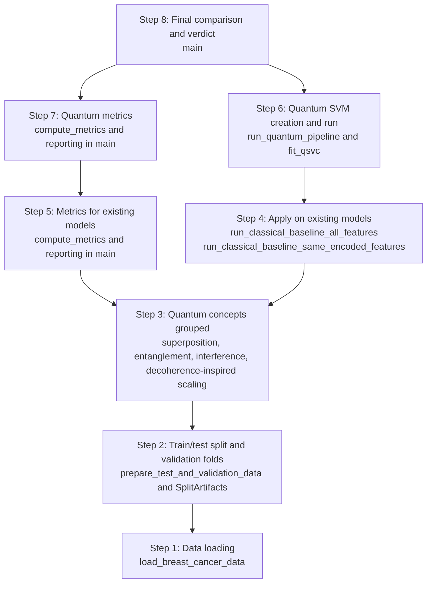

# Quantum Kernel Breast Cancer Classification

This project compares a quantum-kernel SVM (QSVC) with tuned classical RBF SVM baselines on the Wisconsin Diagnostic Breast Cancer dataset.

## Layered Flow (Showcase)

The script is organized in two complementary views:

1. A layered architecture
2. A step-by-step execution flow that mirrors the problem-solving process

### A) Layered Architecture in Code

- Layer 1: Config
	- Experiment constants and search spaces
- Layer 2: Data
	- Data loading, plus train/test split and validation fold preparation
- Layer 3: Quantum Concept Grouping
	- Superposition encoding, entanglement maps, interference kernel, and decoherence-inspired scaling
- Layer 4: Models
	- Classical SVM and quantum SVM selection/training logic
- Layer 5: Evaluation
	- Metrics, kernel alignment, and significance testing
- Layer 6: Visualization
	- Circuit diagram, selection heatmap, ROC/confusion, leaderboard, and significance plots
- Layer 7: Pipeline
	- End-to-end orchestration from data loading to final verdict

### B) Step-by-Step Flow (1 to 8)

The implementation follows this exact sequence:

1. Load the breast-cancer dataset
	- `load_breast_cancer_data()`
2. Prepare train/test and validation folds
	- `prepare_test_and_validation_data()`
3. Group quantum concepts in code
	- Superposition: `apply_superposition_encoding()`
	- Entanglement: `build_feature_map()`
	- Interference: `quantum_gram()`
	- Decoherence-inspired scaling: `decoherence_bandwidth_scale()`
4. Apply logic to the existing classical model
	- `run_classical_baseline_all_features()`
5. Score metrics for the existing model
	- `compute_metrics()` and test reporting in `main()`
6. Create and run the quantum SVM pipeline
	- `run_quantum_pipeline()` and `fit_qsvc()`
7. Score metrics for the quantum model
	- `compute_metrics()` and side-by-side reporting in `main()`
8. Produce the final comparison
	- Head-to-head comparison in `main()`
	- Repeated-CV significance testing and verdict output

When you run the script, the console prints each stage as `[1/8]` through `[8/8]` so the flow is easy to present.

## Qollab Simulator Modes

The same script supports two modes, controlled by `RUN_MODE` near the configuration constants:

- `local` (default): runs the full grid-search benchmark with `FidelityStatevectorKernel`. In Qollab, upload this script as `main.py`, include `requirements.txt`, choose a free local simulator, and run the project.
- `ionq`: set `RUN_MODE = "ionq"`, upload the script as `main.py`, and select a free IonQ remote simulator. Qollab's current IonQ endpoint accepts `ionq.circuit.v1` single-circuit jobs but rejects Qiskit-IonQ multi-circuit batches (`ionq.multi-circuit.v1`). This mode therefore submits one measured fidelity circuit for a pair of encoded breast-cancer samples and writes `outputs/ionq_results.json`. It verifies IonQ execution; it does not train or evaluate a classifier. Use `local` mode for the full benchmark and its classification metrics.

The IonQ mode is a reduced backend-backed experiment, not the full local grid search, and its metrics should not be presented as directly comparable to the full benchmark. Qollab's injected backend is only used in `ionq` mode. Do not add provider setup or a second `main()` call in Qollab; its runtime invokes the entry point. Run locally with `RUN_MODE = "local"` using `python quantum_kernel_breast_cancer.py`.

### C) Implementation Mapping (Exact References)



Reference map to source lines:

1. Step 1: [quantum_kernel_breast_cancer.py:84](quantum_kernel_breast_cancer.py#L84)
2. Step 2: [quantum_kernel_breast_cancer.py:93](quantum_kernel_breast_cancer.py#L93), [quantum_kernel_breast_cancer.py:71](quantum_kernel_breast_cancer.py#L71)
3. Step 3: [quantum_kernel_breast_cancer.py:128](quantum_kernel_breast_cancer.py#L128), [quantum_kernel_breast_cancer.py:133](quantum_kernel_breast_cancer.py#L133), [quantum_kernel_breast_cancer.py:144](quantum_kernel_breast_cancer.py#L144), [quantum_kernel_breast_cancer.py:149](quantum_kernel_breast_cancer.py#L149)
4. Step 4: [quantum_kernel_breast_cancer.py:409](quantum_kernel_breast_cancer.py#L409), [quantum_kernel_breast_cancer.py:422](quantum_kernel_breast_cancer.py#L422)
5. Step 5: [quantum_kernel_breast_cancer.py:428](quantum_kernel_breast_cancer.py#L428)
6. Step 6: [quantum_kernel_breast_cancer.py:415](quantum_kernel_breast_cancer.py#L415)
7. Step 7: [quantum_kernel_breast_cancer.py:428](quantum_kernel_breast_cancer.py#L428)
8. Step 8: [quantum_kernel_breast_cancer.py:428](quantum_kernel_breast_cancer.py#L428)

## Project Files

- `quantum_kernel_breast_cancer.py`: Main experiment script
- `requirements.txt`: Python dependencies
- `outputs/`: Generated after running (figures and `results.json`)

## Prerequisites

- Python 3.10 or newer
- pip (usually bundled with Python)

## 1. Create a Virtual Environment

From the project folder:

```bash
cd /Users/techyvenki/Documents/quantum-world/qubit-mind
python3 -m venv .venv
```

## 2. Activate the Virtual Environment

macOS / Linux:

```bash
source .venv/bin/activate
```

Windows (PowerShell):

```powershell
.venv\Scripts\Activate.ps1
```

Windows (Command Prompt):

```bat
.venv\Scripts\activate.bat
```

## 3. Install Dependencies

```bash
python -m pip install --upgrade pip
pip install -r requirements.txt
```

## 4. Run the Program

```bash
python quantum_kernel_breast_cancer.py
```

## 5. Check Results

After the run finishes, check:

- `outputs/results.json`
- PNG figures inside `outputs/`

## Optional: Deactivate the Environment

```bash
deactivate
```

## Troubleshooting

- If `python` is not found, use `python3` in the commands.
- If activation is blocked in Windows PowerShell, open PowerShell as Administrator and run:

```powershell
Set-ExecutionPolicy -ExecutionPolicy RemoteSigned -Scope CurrentUser
```

Then close and reopen PowerShell, and activate again.

## Submission Compliance

This section maps the project to the submission guidelines and shows what is complete versus what still needs attention before final submission.

### Guideline Status

- [x] Use the Qiskit framework
	- The project uses Qiskit and Qiskit Machine Learning (`QSVC`, feature maps, and quantum kernels).
- [x] Run on Qollab free simulators (including IonQ simulator)
	- Both a full local-simulator mode and a reduced IonQ-backend mode are implemented.
	- Verify and document a successful run in each mode; backend selection alone does not route the local statevector kernel to IonQ.
- [x] Be published and runnable on Qollab.xyz before the deadline
	- Publish this project on Qollab.xyz and confirm that it runs there.
- [x] Use MIT license
	- This repository includes an MIT license in `LICENSE`.
- [x] Ensure any outside repo dependency also uses MIT license
	- If you rely on external frontend/backend repositories, verify and document their license status.
- [x] Have a complete project page on Qollab.xyz
	- Include the purpose, problem explored, run steps, outputs, and replication details.
- [x] Built during hackathon window with originality disclosure
	- Add a short disclosure covering any pre-existing templates/code and what was built during the event.

### License Verification Evidence

- Repository license status:
	- GitHub detects this repository as MIT (visible on the repository `LICENSE` page).
- Dependency license audit workflow:
	- Generate a machine-readable dependency license report:

```bash
.venv/bin/python -m pip install pip-licenses
.venv/bin/pip-licenses --format=markdown --with-urls --output-file docs/compliance/dependency_licenses.md
```

- Evidence artifact:
	- Keep `docs/compliance/dependency_licenses.md` with your submission materials as review evidence.
- Review rule:
	- Confirm that each listed dependency license is acceptable for your submission requirements.
	- If any dependency is non-MIT but allowed by event rules, document that explicitly on the project page.

### Notes for Judges

- Dataset is loaded with `sklearn.datasets.load_breast_cancer` (no manual data download required).
- Main entry point: `python quantum_kernel_breast_cancer.py`.
- Outputs are written to `outputs/` (`results.json` and figures).
- Dependency license evidence is available in `docs/compliance/dependency_licenses.md`.

### Originality Disclosure

This section records what existed before the hackathon and what was built during the hackathon window.

#### Starting Point

- Pre-existing code used: No direct starter repository or template code was copied into this project.
- Source repository/template/fork and license: N/A
- Components reused without modification:
	- `sklearn.datasets.load_breast_cancer` dataset loader (API usage)
	- Qiskit and Qiskit Machine Learning APIs (`QSVC`, feature maps, fidelity kernel)

#### External Learning and Reference Material

This project uses official Qiskit documentation/tutorials as learning references:

- Quantum Kernel Tutorial: https://qiskit.org/ecosystem/machine-learning/tutorials/03_quantum_kernel.html
- Training a quantum kernel with Quantum Kernel Alignment: https://qiskit.org/ecosystem/machine-learning/tutorials/08_quantum_kernel_trainer.html
- QSVC API: https://qiskit.org/ecosystem/machine-learning/locale/fr_FR/stubs/qiskit_machine_learning.algorithms.QSVC.html

Suggested disclosure wording:

- We consulted official Qiskit tutorials and API documentation for conceptual understanding and API usage.
- The project code in this repository was implemented and adapted for this specific breast-cancer classification workflow, evaluation flow, and reporting requirements.
- Any reused snippets should be explicitly identified in commit history or comments when applicable.

#### AI-Assisted Work

- AI tools, including GitHub Copilot, were used to help draft and refine project documentation and to build a deeper understanding of the features, APIs, and workflow used in the project.
- AI tools were also used to help generate and refine project images and visual assets.

#### Built During Hackathon

- New features added:
	- End-to-end quantum vs classical benchmark flow for breast-cancer classification.
	- Layered pipeline with an explicit 8-step execution flow and grouped quantum concepts.
	- Automated outputs: comparison metrics, significance analysis, kernel alignment, and visualization artifacts.
- Model/algorithm changes made during event:
	- Added quantum model selection across feature maps, reps, bandwidth, and SVM C.
	- Added a matched classical RBF baseline on identical encoded features for fair head-to-head comparison.
	- Added repeated stratified CV with a corrected resampled paired t-test for significance.
- Documentation, reproducibility, or packaging work completed during event:
	- Updated README with setup/run guidance, layered flow, mapping, and originality disclosure.
	- Added and maintained `requirements.txt`, `LICENSE`, and generated `outputs/results.json` plus figures.

#### Theme and Problem Selection

The four team members discussed all three available themes and reviewed the datasets and project requirements associated with them. After comparing the options and evaluating the available information, the team selected Theme 1, Prompt A: **"Can a Quantum Circuit Spot a Tumor?"** The team then focused the project on breast-cancer classification using the Wisconsin Diagnostic Breast Cancer dataset.

#### Team Contributions

- **Venkatesh Duvvuri:** Developed and enhanced the project code, created the project in Qollab, and worked to verify that the code ran successfully in the Qollab environment.
- **Harsha Balusu:** Contributed to developing and enhancing the project code.
- **Surya Malapaka:** Contributed to the initial project analysis, gathered resources needed for the work, and helped establish the project setup and documentation.
- **Bharath Alapathi:** Contributed to the initial project analysis, gathered resources needed for the work, and helped establish the project setup and documentation.

The team collaborated on reviewing the themes and datasets and agreed on the final problem statement and project direction.

#### Evidence

- Demo/video/screenshots:
	- Generated artifacts available in `outputs/` (leaderboard, ROC/confusion, model-selection, significance plots).
